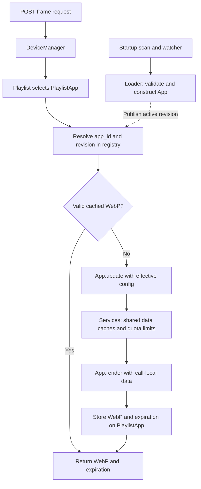

# API architecture plan

This document describes the intended architecture, including changes that are not
implemented yet. The current frame endpoint is `GET /api/current` and uses a
process-wide carousel. The target is a POST request routed through a device's own
playlist. Existing work in `models/Device.py`, `models/Playlist.py`,
`models/App.py`, and `models/Registry.py` provides the starting vocabulary.

## Layer overview

| Layer | Responsibility | State it owns |
| --- | --- | --- |
| Device / DeviceManager | Identify the requesting device and coordinate its next graphic request. | Device metadata, request tracking, its playlist, and coordination of requests for that device. |
| Playlist / PlaylistApp | Choose a graphic, supply that placement's configuration, and reuse its rendered WebP while valid. | Entry ordering, current position, configuration overrides, cached graphic bytes, and graphic expiration. |
| App | Define one particular graphic through a common update/render interface. | Stable app ID, default configuration, updater, and renderer. No per-device working data. |
| Services | Supply reusable data through internal APIs while managing upstream requests. | Provider clients, credentials, quota accounting, locks, shared data caches, and data expiration. |

Two supporting components connect these layers:

- The **app registry** maps a permanent `app_id` to the currently active `App`.
- The **loader and watcher** discover app files, assign identities to new apps,
  validate implementations, and publish replacements into the registry.

An app represents a graphic, not a category of data. Two visually different
clocks are different apps. A clock/weather combination is another app. They can
all use the same underlying services.



## 1. POST endpoint: receive a device request

Use `POST /api/current` as the proposed frame endpoint. The exact public request
schema can evolve; the minimum request identifies the device and the logical
request:

```json
{
  "device_id": "<persistent device UUID>",
  "request_id": "<UUID identifying this logical request>"
}
```

The endpoint validates the request, resolves the device's DeviceManager, and asks
it for the next graphic. It returns WebP bytes with `Content-Type: image/webp`.
Return the graphic's absolute expiration in response metadata, such as an
`X-Graphic-Expires-At` header containing a UTC ISO 8601 timestamp.

Do not cache this POST response solely by endpoint URL: it depends on the device
and playlist state. The server-side playlist cache described below is the main
graphic cache.

The endpoint is transport code. Playlist selection, rendering, and upstream API
access belong to the layers below it. The existing `POST /api/logs` remains a
separate logging operation.

## 2. DeviceManager: resolve and coordinate a device

Maintain a lookup from `device_id` to the device's manager/state. The existing
`DeviceManager` class is structured around one device; a top-level device lookup
can own those instances without requiring a single process-wide playlist.

Each device has:

- `device_id`, `created_at`, and optional `owner_id`.
- `last_request_at` and `last_request_id` for request tracking.
- Its own `Playlist` and current playlist position.
- Coordination so simultaneous requests cannot accidentally corrupt its cursor
  or publish mismatched graphic bytes and expiration metadata.

Resolve an existing device or create it according to the registration policy.
Assign a default playlist when a device is created; reject invalid identifiers
before creating state. A device's persistent identity is distinct from any app ID.

For an initial implementation, serialize the selection/render/commit flow per
device. Other devices remain independent. A later implementation can shorten the
critical section by reserving an entry and validating its version before commit.

The ESP32 sends requests in order. It retries the same `request_id` until the
response succeeds, then generates a new ID to request the next app. It does not
revisit older IDs after moving on. Keep the playlist on the currently selected
entry until a new ID arrives; the first request uses the initial entry without
advancing. Record a new ID's selection before rendering so a failed render or
lost response cannot make a retry advance again.

DeviceManager stores no response-byte history. Repeated current IDs call the
current PlaylistApp through the playlist and reuse its cached WebP while valid.
Normal freshness/config/revision rules still apply, so a retry may regenerate an
expired graphic while staying on the same entry. An active request ID records
selection separately from latest-attempt tracking; an empty playlist selects
nothing and must not cause the initial entry to be skipped when later populated.

## 3. Playlist: select a PlaylistApp and check its graphic cache

Each device owns a playlist. Its ordering and cursor are independent of every
other device, even when their entries reference the same apps.

`Playlist` contains an ordered list of `PlaylistApp` entries and a current index.
Derive the number of apps from the list rather than maintaining a second count
that can become inconsistent.

Each `PlaylistApp` represents one placement of a graphic:

| Field | Meaning |
| --- | --- |
| Entry ID | Stable identity of this playlist placement; survives reordering. |
| `app_id` | Foreign reference to the shared graphic implementation. |
| `name` | Optional placement label; not the app's identity. |
| `config` | Device/placement-specific settings, such as location, timezone, units, and 24-hour time. |
| `cached_gfx_bytes` | Most recently generated WebP for this placement. |
| `cached_gfx_expires` | Absolute deadline after which those bytes need refreshing. |
| Cache identity | App revision, effective-config fingerprint, and output dimensions/options used to generate the bytes. |

Configuration values need to support JSON-compatible types, including booleans,
numbers, lists, and nested objects; `dict[str, str]` is too restrictive.

An index is ordering, not identity. The same `app_id` can appear multiple times
in a playlist with different configurations and independent graphic caches.

For each request:

1. Keep the current entry for a retry. For a new ID, advance once to select the
   next entry; the initial request starts at entry zero. Apply unavailable-entry
   fallback rules with at most one full rotation.
2. Resolve its `app_id` to a registry snapshot and form its effective config.
3. Check the cached WebP's expiration and cache identity.
4. On a valid cache hit, return those bytes without invoking an updater,
   renderer, or service.
5. On a cache miss, invoke the resolved App as described below.
6. Commit successful bytes and their metadata together. Keep the cursor on this
   entry until the device sends a new request ID.

Advancing the playlist and expiring a graphic are separate concepts. For example,
the playlist may revisit a weather graphic after 60 seconds and reuse its WebP
because the data-backed graphic remains valid for ten minutes. Display duration
is also separate from freshness; a long TTL does not require keeping an entry on
screen for that long.

Invalidate the graphic immediately when its configuration, output format/size,
or app revision changes. Confirm the app is still registered before returning a
cached image so removal policy is respected. Expired or incompatible bytes are
not considered a normal cache hit.

Skip an unavailable app without deleting its playlist entry. If no entry can be
served, return a defined fallback graphic. Bound failures and retries so a broken
entry cannot trap the request in an endless rotation. Do not replace a good cache
with a partial render or an exception; serving expired bytes must be an explicit
fallback policy with a short retry deadline.

## 4. App registry: resolve stable identity to the active implementation

The central mapping is:

```python
from models.Registry import app_registry

assert app_registry[app_id].id == app_id
```

Playlist entries store IDs rather than direct App references. Replacing one
registry entry changes the implementation used by future lookups without editing
any playlists. Python already supports many references to one object; the registry
adds the indirection required to replace that object centrally.

The registry owns one active App per ID per worker process. There is no need to
spawn or destroy an App for every request, device, or configuration. Multiple
instances would not create additional execution capacity; function implementations
can be invoked repeatedly with independent call-local data.

Keep the app's display metadata and code revision in accompanying registry/catalog
records so the App itself can retain its four-field design. Expose a coordinated
snapshot containing the App and revision. A request resolves that snapshot once
and uses it for both update and render.

`models/Registry.py` implements a synchronized mapping named `app_registry`.
Mapping reads return Apps; `get_registration(app_id)` returns an App plus its
name, author, revision, and optional source path as one metadata snapshot.
`register_module()` validates an already loaded module, binds the shared services,
constructs the App, and publishes it only after validation succeeds. It does not
scan directories, assign permanent IDs, or start a watcher.

For example, after a loader has resolved the persistent ID:

```python
from apps import clock_contract
from models.Registry import app_registry

registration = app_registry.register_module(
    app_id, clock_contract, services=services, revision=source_revision
)
```

The revision may be supplied as a content/dependency hash by the loader. If omitted,
the registry creates a unique registration revision. The permanent app ID is never
derived from that revision. Importing the app package no longer registers legacy
modules; endpoint migration and automatic loading are separate implementation steps.

Publish a fully constructed replacement under synchronization. New lookups receive
the replacement; an in-flight request retains the previous snapshot. Tag its
result with the revision actually used, so the next request invalidates it if
necessary. Do not mutate a published App's function fields in place.

## 5. App: apply configuration, update data, and render the graphic

The simplified App contains:

```python
class App:
    id: str
    config: dict
    update_fn: Callable
    render_fn: Callable
```

`App.config` contains app defaults and policy, such as default timezone, units,
visual options, and a default graphic TTL. Treat published defaults as read-only.
They do not hold request counters, live locks, per-device caches, or mutable
working data.

Build a fresh effective configuration for each call from defaults and the
PlaylistApp's overrides. Define nested configuration merging explicitly; a shallow
dictionary merge only replaces top-level values. Validate before invoking the
app. Keep provider credentials and service policy outside device-controlled
configuration.

An optional `App.update()` or `App.render()` method can forward to the corresponding
callable. Those methods must pass inputs and return outputs without storing
request-specific data on the shared App.

### Module contract and service binding

Each app module provides metadata plus two standard entry points:

```python
NAME = "My Cool Clock"
AUTHOR = "display username"
DEFAULT_CONFIG = {"timezone": "America/New_York", "24hourtime": False}

def update(config, *, services):
    # Return call-local data and an absolute refresh deadline.
    ...

def render(data, config):
    # Return WebP bytes and an absolute graphic expiration.
    ...
```

The app neither constructs an App nor registers itself. Metadata and definitions
can be evaluated at import time; fetching upstream data or registering with the
server is not an import-time responsibility.

The loader can bind `services` with `functools.partial` or a closure so the stored
updater is called with only its effective config. This preserves the four-field
App design. Internal service APIs can initially be ordinary Python calls; they
do not require loopback HTTP requests.

The updater asks services for data and prepares the graphic's inputs. The renderer
creates its own images, drawing contexts, and byte buffers. Requests must not
modify shared service cache objects or use a shared image as a scratch buffer.

### Results and expiration

The current App/Playlist implementation uses `dict | None` from update and
`(bytes, timezone-aware datetime)` from render. An updater can carry its absolute
deadline in that per-call data, and the renderer returns the same or an earlier
deadline. `clock_contract.py` demonstrates this without renewing expiration.

If services later introduce explicit result objects, the proposed shapes are:

```python
UpdateResult(data=..., expires_at=...)
RenderResult(image=..., expires_at=...)
```

The updater's deadline reflects the input data and required update schedule. The
renderer may supply an earlier deadline for a visual change. The final graphic
deadline is the earliest applicable input, update, and render deadline. A default
TTL provides a policy when no more specific deadline exists; it must not extend
an already earlier deadline.

Use timezone-aware UTC datetimes for stored and returned deadlines. An entry is
fresh only while `now < expires_at`. Compute deadlines from the relevant data or
time snapshot, not blindly from render completion. Never renew old data's TTL
simply because another device requested it or another graphic was generated.

Examples:

- **Weather-only:** a service result fetched at 12:00 with a 12:10 expiration can
  support a graphic valid until 12:10. Rendering it again at 12:08 does not extend
  the weather's expiration to 12:18.
- **Minute-resolution clock:** refresh at the next minute boundary, not always
  60 seconds after rendering. A request at 12:00:45 should refresh by 12:01:00.
- **Clock and weather:** take the earlier of the next displayed time change and
  weather expiration. An expired WebP can be regenerated with current time and
  the same still-valid cached weather.
- **MTA countdown:** arrival timestamps may still be valid while displayed
  remaining minutes change. Graphic expiration accounts for the countdown even
  when no new feed fetch is necessary.

## 6. App loader and watcher: maintain the registry

These components run at startup and in the background, not as a source-file scan
on every frame request. The registry is the request-time lookup surface.

### Discovery and permanent identity

Discover direct app files under `apps/api/apps/` (the `apps/` directory relative
to the API root). Exclude `__init__.py`, private helper files beginning with `_`,
temporary files, and subpackages reserved for helpers. Keep `apps/__init__.py`
minimal rather than manually importing and registering every app.

Each graphic has its own permanent ID, independent of display name, author
username, configuration, or source code. Two authors can both publish a graphic
named Clock, and a single author can publish multiple clocks.

Use UUID4 assigned once at initial ingestion. Persist identity in the managed
filename:

```text
apps/my_cool_clock.py
    -> apps/app_8a9f734c0b224eaf9dbb97d56d3e8120.py

app_id = "8a9f734c0b224eaf9dbb97d56d3e8120"
```

The loader extracts and validates the UUID from an existing managed filename.
Do not generate a new ID on restart, reload, display-name change, or source edit.
The filename can be the source of identity for this workflow; persist richer
metadata in a catalog/manifest if needed. Update the existing managed file to
publish a new revision. A new unidentified file creates a new app even if its
name matches an existing app.

An alternative is UUID5 derived from a fixed namespace, immutable author ID, and
immutable publication key. Hashing an editable username and display name does
not provide stable identity. A code/content hash belongs to the revision and
cache invalidation mechanism, not the permanent app ID. An ID also does not prove
authorship; resolve conflicting copies explicitly rather than silently overwriting
another app.

### Startup and new-file ingestion

1. Initialize long-lived services and the empty registry.
2. Scan managed and unidentified app files in a deterministic order.
3. Load a candidate into a fresh module namespace and validate metadata and both
   callables against the expected interface. Do not call the updater merely to
   discover an app.
4. For an unidentified valid candidate, assign `uuid.uuid4().hex`, rename to the
   managed filename without overwriting an existing destination, and persist any
   accompanying catalog metadata. Complete identity persistence before publishing.
5. Bind service access, construct an App whose ID matches its key, and record its
   revision and source path. Support managed-path-relative assets by making the
   final source location available before normal execution.
6. Publish the validated App and metadata together.
7. Start watching and reconcile the directory again to cover changes that occurred
   between the initial scan and watch startup.

One ingestion coordinator assigns IDs and renames files. Multiple workers must
not independently assign different IDs to the same submitted file. Treat the
coordinator's own rename events as reconciliation of an existing managed app.

### Watcher events and replacement

| Event | Action |
| --- | --- |
| New unidentified file | Validate, assign permanent ID, rename, and register. |
| New managed file | Validate its ID and load it without generating another ID. |
| Managed file changed | Build a complete candidate revision, then replace its registry snapshot. |
| Invalid replacement | Report the error and retain the active working revision. |
| Managed file removed | Unregister after reconciliation; retain playlist references so entries can recover if restored. |

Debounce/coalesce editor events and rescan actual directory state. Many editors
save by creating a temporary file and renaming it; do not interpret each raw event
as a separate new app or immediate permanent deletion. Serialize loader mutations
and coordinate registry publication with readers.

Load each revision into a fresh module namespace. Ordinary `importlib.reload()`
reuses the existing module dictionary, so old functions may observe new globals;
it does not provide the isolation needed for in-flight requests. Keep old revision
objects alive while requests reference them, then let normal object lifetime
management release them. Avoid app-owned background tasks that outlive a revision.

Fresh namespaces isolate the app module itself, not arbitrary imported helper
modules. Define a coordinated policy for helper changes and include relevant
dependencies/assets in revision invalidation; restart workers for changes outside
the supported reload boundary. Keep service objects independent from replaceable
graphic modules so reloads do not reset quota counters or shared data caches.

## 7. Services: share data, caching, and upstream quota enforcement

Provide internal APIs for Weather, MTA, Flights, and optionally Clock. Graphic
authors use these APIs rather than contacting providers directly. Services own
provider URLs, credentials, timeouts, parsing, retries, rate-limit handling, and
normalized results. Provider-specific code stays in one place.

Example interfaces:

```python
services.weather.current(location=..., units=...)
services.mta.arrivals(stop_id=..., direction=..., lines=...)
services.flights.in_area(bounds=...)
services.clock.now(timezone=...)
```

Clock is an optional interface for consistency and testability. Reading current
time needs no external request or stale snapshot cache. It can supply the next
display-change deadline alongside the current value.

### Cache ownership and keys

Services return results such as:

```python
ServiceResult(data=..., fetched_at=..., expires_at=...)
```

Cache by normalized data requirements, not by device ID, playlist entry, graphic
name, or app ID. Do not merge queries that require materially different data.
Conversely, do not split equivalent queries just because their input spelling or
configuration ordering differs.

- **Weather:** share NYC weather for approximately 10–20 minutes when that is the
  configured freshness policy. Use normalized location and relevant query options.
  If storing canonical units and converting locally, unit variants can share the
  upstream result.
- **MTA:** cache at the provider feed level where one fetch serves many lines and
  stations, then derive stop/direction/line views from that feed. Keep arrival
  timestamps so countdown text can change without refetching the feed.
- **Flights:** cache normalized areas or explicitly defined reusable area buckets.
  A wider cached area may serve a smaller query when coverage and freshness permit.
  Cache flight/airline/route metadata separately where its lifetime differs from
  live aircraft positions.

Each service chooses TTLs appropriate to the source. The weather example is a
design policy, not a claim about a provider's contractual request limits. Configure
actual upstream quotas separately. Bound cache sizes and remove unused entries.

### Cache misses, refresh coordination, and limits

For a service call:

1. Normalize its cache key and return a fresh cached result if available.
2. Coordinate refreshes for that key. If a refresh is already running, await its
   result or use explicitly permitted stale data.
3. Recheck freshness after acquiring refresh ownership.
4. Check and reserve upstream quota atomically before starting an external call.
5. Release the quota-accounting lock before network I/O; retain refresh ownership
   for the cache key until completion.
6. Fetch and validate the response, then publish data and timestamps together.
7. Release refresh ownership and notify waiting callers even if fetching fails.

This prevents a burst of devices from launching duplicate NYC weather requests
when one cache entry expires. Per-key refresh coordination and provider-wide quota
accounting solve different problems and should not be one lock around all work.

Scope quota state to the actual provider/account/credential budget, including any
endpoint-specific limits. Multiple weather graphics and combination graphics must
consume the same budget when using the same credential. Count relevant attempts,
including retries, according to provider policy. Apply timeouts and bounded retries;
honor rate-limit responses rather than repeatedly retrying immediately.

If quota is unavailable or the provider fails, use an explicit stale-data policy
or return an unavailable result with a retry deadline. Do not label expired data
fresh or publish an error as valid source data. Apps can render a defined fallback
from an unavailable result.

App-specific shared runtime state, if later needed, belongs in a runtime store
keyed by stable app ID. Cross-app provider state belongs to services. Neither
belongs in per-device config or in a replacement App's default config.

## 8. Return path and complete example

On a cache miss, the request returns through the same layers:

1. Services supply cached or newly fetched data and its expiration metadata.
2. App.update prepares per-call inputs and their refresh deadline.
3. App.render produces WebP bytes and the final graphic deadline.
4. The PlaylistApp stores bytes, deadline, config identity, and used app revision
   as one cache record. Do not overwrite a newer entry configuration with the
   result of an older in-flight render.
5. DeviceManager returns the graphic while retaining the selected entry. Request
   tracking and any advancement already happened before graphic generation.
6. The endpoint returns WebP bytes and expiration metadata.

Consider two devices using different NYC weather graphics and a third using a
clock/weather combination:

- Device A misses its graphic cache. The weather service fetches NYC weather once
  and caches it until 12:10. A's rendered graphic expires no later than 12:10.
- Device B renders a different weather layout from the same service data without
  another upstream request. B keeps its own WebP.
- Device C renders current time with the same cached weather. Its graphic expires
  at the next minute boundary or weather expiration, whichever comes first.
- A returns to its weather entry after 60 seconds and serves its WebP directly.
- C returns after its clock deadline and rerenders with current time while the
  weather service continues to serve cached data.
- When weather expires, concurrent service callers coordinate one refresh for
  that cache key, subject to the shared quota budget.

## 9. Concurrency, workers, and state lifetime

Sharing an App does not serialize its function calls automatically. Each invocation
has its own local variables; safety depends on keeping request-specific mutable
data local and coordinating intentional shared state.

With the current style of `async def` endpoint, directly invoking synchronous
network requests or rendering occupies the event-loop thread. Use asynchronous
service I/O or explicitly offload blocking work. A synchronous FastAPI `def` route
runs in a thread pool, but CPU-heavy Python work still has the usual GIL constraints
on standard CPython. Use worker processes or an appropriate process pool when
measured rendering cost requires CPU parallelism; extra App instances do not
provide it. Native image operations may have different parallelism characteristics.

Use synchronization appropriate to execution context: coroutine coordination for
async tasks, thread synchronization for shared threaded state, and cross-process
coordination for state shared across workers. Do not hold a blocking thread lock
across an `await` on the event-loop thread.

| State | Must survive App replacement? | Multi-worker requirement |
| --- | --- | --- |
| App implementation | Replaced with a new revision. | Every worker must load the published revision. |
| App ID and metadata | Yes. | Shared persistent identity/catalog. |
| Device playlist and cursor | Yes. | Shared coordination/state or explicit single-owner routing per device. |
| Graphic cache | Can be invalidated by revision/config changes. | Shared storage or an explicit per-worker cache policy. |
| Service data cache | Yes. | Shared backing/central service for API-wide reuse; per-worker caches alone duplicate fetches. |
| Quota counters and refresh coordination | Yes. | Shared authoritative coordination across all callers using the quota. |

An initial single-worker deployment can use in-memory device state, service caches,
and locks. This state is lost on process restart unless persisted. Before adding
workers, move quota enforcement and refresh coordination to shared backing or a
central service, and settle device cursor/retry ownership. Thread locks do not
coordinate separate worker processes.

For multiple workers, one coordinator ingests files and publishes revision events;
each worker loads and swaps its own registry entry. A filesystem event alone does
not guarantee simultaneous activation across workers. Requests can finish on their
captured revisions, and cache records must retain the actual revision used.

## 10. Implementation sequence and acceptance checks

1. Finalize the four-field App, result types, effective-config rules, and registry
   snapshot contract. Replace manual module-level App construction/registration.
2. Finish PlaylistApp and per-device Playlist behavior, graphic cache metadata,
   cursor rules, and the unavailable-app fallback.
3. Add DeviceManager lookup, per-device coordination, request tracking, and the
   POST frame endpoint. Remove dependence on the global carousel for device frames.
4. Extract existing Weather, MTA, and Flights provider access into services with
   normalized keys, expiration metadata, quota accounting, and refresh coordination.
5. Adapt app modules to the common update/render contract and injected services.
6. Add startup discovery, UUID ingestion/renaming, and catalog/revision tracking.
7. Add the watcher, candidate validation, isolated revision loading, and coordinated
   registry replacement/removal.
8. Add persistent/shared backing and worker coordination before scaling beyond
   the explicitly supported single-worker state model.

Validate the architecture with behavior-focused scenarios:

- Two devices retain independent playlist positions and configurations.
- One app is placed twice with different settings without sharing working data.
- A valid WebP cache hit invokes no updater, renderer, or service.
- Several graphics requesting equivalent weather reuse one service cache entry.
- Simultaneous misses for one service key launch one upstream refresh.
- Different apps sharing a provider credential respect one quota budget.
- Clock/weather rerenders at clock boundaries without refetching fresh weather.
- Cached source data never gains a later expiration merely by being rendered again.
- A new unidentified file gets one ID, survives restart, and is not registered
  twice because of its rename event.
- An invalid replacement leaves the active implementation available.
- A valid replacement preserves app ID and playlist references, invalidates old
  graphic caches, and leaves service counters/data intact.
- An in-flight request completes consistently with its captured revision.
- Removal, empty playlists, upstream failures, repeated request IDs, and concurrent
  requests for one device follow their defined fallback/cursor policies.

## Reference notes

- [FastAPI concurrency](https://fastapi.tiangolo.com/async/) explains synchronous
  route thread-pool execution and asynchronous handlers.
- [FastAPI deployment concepts](https://fastapi.tiangolo.com/deployment/concepts/)
  explains separate worker memory.
- [Python importlib](https://docs.python.org/3.13/library/importlib.html) documents
  import cache invalidation, reload behavior, and reload synchronization limits.
- [Python UUID](https://docs.python.org/3.13/library/uuid.html) documents UUID4 and
  deterministic UUID5 identities.
- [Python datetime](https://docs.python.org/3.13/library/datetime.html) documents
  aware UTC timestamps.
